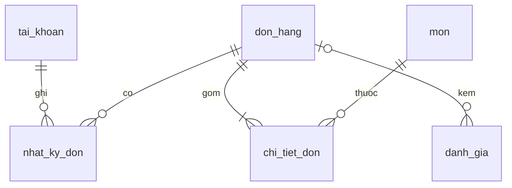

# ĐỦ WOW CHƯA – web đặt đồ uống có máy chủ và cơ sở dữ liệu

Khách bấm **Đặt đơn** là đơn **tự vào danh sách của chủ quán**, không còn bước sao chép rồi gửi Zalo/SMS.
Chủ quán đăng nhập để xem đơn, báo "Đã lấy đơn / Đang giao / Giao thành công", báo hết hàng, duyệt đánh giá, thêm món và đổi ảnh.
Khách xem được tình trạng đơn của mình theo mã đơn.

Dự án làm theo mô hình **MVC nhiều lớp** giống báo cáo ký túc xá DormitoryHaUI (Model – Repository/Service – Controller – View, phân quyền Admin, mật khẩu mã hóa, bảng dữ liệu có khóa chính/khóa ngoại), nhưng viết bằng Node.js + SQLite để chạy nhẹ và rẻ.

## 1. Chạy thử trên máy tính

Cần cài **Node.js 22.13 trở lên** (https://nodejs.org).

```bash
npm install
ADMIN_PASSWORD="mật-khẩu-của-bạn" npm start      # Windows PowerShell: $env:ADMIN_PASSWORD="..." ; npm start
```

Mở http://localhost:3000. Chủ quán bấm biểu tượng ổ khóa nhỏ ở cuối trang, nhập tài khoản `shop` và mật khẩu vừa đặt.
Nếu không đặt `ADMIN_PASSWORD`, máy chủ tự tạo mật khẩu và in ra màn hình **một lần duy nhất** ở lần chạy đầu.

Chạy bộ kiểm thử: `npm test` (11 kịch bản: đặt đơn, tính tiền, hết hàng, trạng thái đơn, đăng nhập, đánh giá, thêm món...).

## 2. Đưa lên mạng để khách dùng

Máy chủ cần: Node.js 22.13+, **một ổ đĩa lưu lâu dài** (để không mất đơn khi khởi động lại) và HTTPS (nơi lưu web thường có sẵn).

Cách nhanh với **Render.com** (đã kèm file `render.yaml`):
1. Đưa thư mục này lên một kho GitHub riêng tư.
2. Trên Render chọn **New → Blueprint**, chọn kho vừa tạo.
3. Nhập biến `ADMIN_PASSWORD` (mật khẩu chủ quán) khi được hỏi.
4. Khi xong, Render cho một địa chỉ dạng `https://duwow-xxxx.onrender.com`. Gửi địa chỉ đó cho khách.

Lưu ý quan trọng:
- Gói **miễn phí** của Render **không có ổ đĩa lưu lâu dài**, mỗi lần máy khởi động lại là mất đơn, và máy "ngủ" khi vắng khách nên lần mở đầu chậm. Quán thật nên dùng gói có ổ đĩa (file `render.yaml` đã khai báo sẵn ổ đĩa `/var/data`), hoặc Railway, Fly.io, hoặc một máy chủ VPS nhỏ.
- Có thể chạy bằng Docker: `docker build -t duwow . && docker run -p 3000:3000 -v duwow-data:/data -e ADMIN_PASSWORD=... duwow`.
- Sao lưu: chép file `duwow.sqlite` trong thư mục dữ liệu (`DATA_DIR`) định kỳ.

## 3. Cấu trúc (MVC nhiều lớp)

```
server.js                   khởi động
db/schema.sql               thiết kế cơ sở dữ liệu
src/
  app.js                    lắp các lớp lại với nhau
  routes.js                 bảng định tuyến API + quyền truy cập
  models/                   MODEL: truy cập bảng dữ liệu (Repository)
  services/                 MODEL: nghiệp vụ (tính tiền, kiểm tra món hết hàng, chuyển trạng thái đơn...)
  controllers/              CONTROLLER: nhận yêu cầu, gọi service, trả kết quả
  middleware/               đăng nhập, phân quyền (RBAC), tiêu đề bảo mật
public/index.html           VIEW: giao diện khách và khu "Dành cho Shop"
public/img/                 ảnh món
test/api.test.js            kiểm thử API
```

### Bảng dữ liệu

| Bảng | Vai trò |
|---|---|
| `tai_khoan` | Chủ quán / nhân viên (`admin`, `staff`), mật khẩu băm bằng scrypt |
| `mon` | Thực đơn: tên, giá, ảnh, `het_hang`, `best` |
| `don_hang` | Đơn: khách, tổng tiền, `trang_thai` 0–3, `thanh_toan` |
| `chi_tiet_don` | Món trong đơn (lưu tên và giá tại lúc đặt), khóa ngoại → `don_hang`, `mon` |
| `nhat_ky_don` | Giờ chuyển từng trạng thái (hiện cho khách theo dõi) |
| `danh_gia` | Đánh giá 1–3 sao, chủ quán duyệt mới hiện (`hien`), có `phan_hoi` |



### API chính

| Ai dùng | Đường dẫn | Việc |
|---|---|---|
| Khách | `GET /api/menu` | Menu, giá, hết hàng |
| Khách | `POST /api/orders` | Đặt đơn (giá do máy chủ tự tính) |
| Khách | `GET /api/orders/:mã/status` | Xem tình trạng đơn |
| Khách | `GET/POST /api/reviews` | Xem và gửi đánh giá |
| Chủ quán | `POST /api/auth/login`, `logout`, `GET me` | Đăng nhập |
| Chủ quán | `GET /api/admin/orders`, `PATCH/DELETE /api/admin/orders/:mã` | Xem đơn, đổi trạng thái, đã thanh toán, xóa |
| Chủ quán | `PUT /api/admin/availability` | Lưu danh sách món hết hàng |
| Chủ quán | `POST/PATCH/DELETE /api/admin/menu` | Thêm món, đổi giá, đổi ảnh, xóa |
| Chủ quán | `GET/PATCH/DELETE /api/admin/reviews` | Duyệt, phản hồi, xóa đánh giá |

### Bảo mật đã làm

- Giá và tổng tiền luôn do máy chủ tính từ cơ sở dữ liệu, giá khách gửi lên bị bỏ qua.
- Mật khẩu băm scrypt có muối; phiên đăng nhập là cookie `HttpOnly` ký HMAC; sai 5 lần bị khóa 1 phút.
- API quản lý chỉ cho người đã đăng nhập đúng quyền; giới hạn số đơn và đánh giá theo địa chỉ IP.
- Màn theo dõi đơn của khách chỉ trả trạng thái, không trả tên, số điện thoại, địa chỉ.
- Ảnh tải lên được kiểm tra loại file, dung lượng; có tiêu đề CSP chặn mã lạ.

## 4. Biến môi trường

| Biến | Ý nghĩa |
|---|---|
| `ADMIN_PASSWORD` | Mật khẩu chủ quán tạo ở lần chạy đầu (nên đặt) |
| `ADMIN_USER` | Tên đăng nhập, mặc định `shop` |
| `DATA_DIR` | Thư mục chứa cơ sở dữ liệu và ảnh tải lên |
| `PORT` | Cổng, mặc định 3000 |
| `NODE_ENV=production` | Bật cookie chỉ gửi qua HTTPS |

Đổi mật khẩu: chạy `node scripts/reset-password.js "mật khẩu mới"` (cùng `DATA_DIR` với máy chủ). Trên Render có thể mở tab Shell của dịch vụ để chạy lệnh này.
